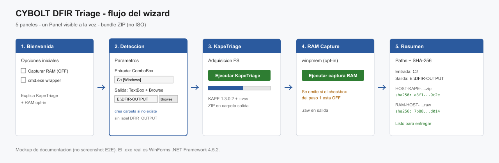
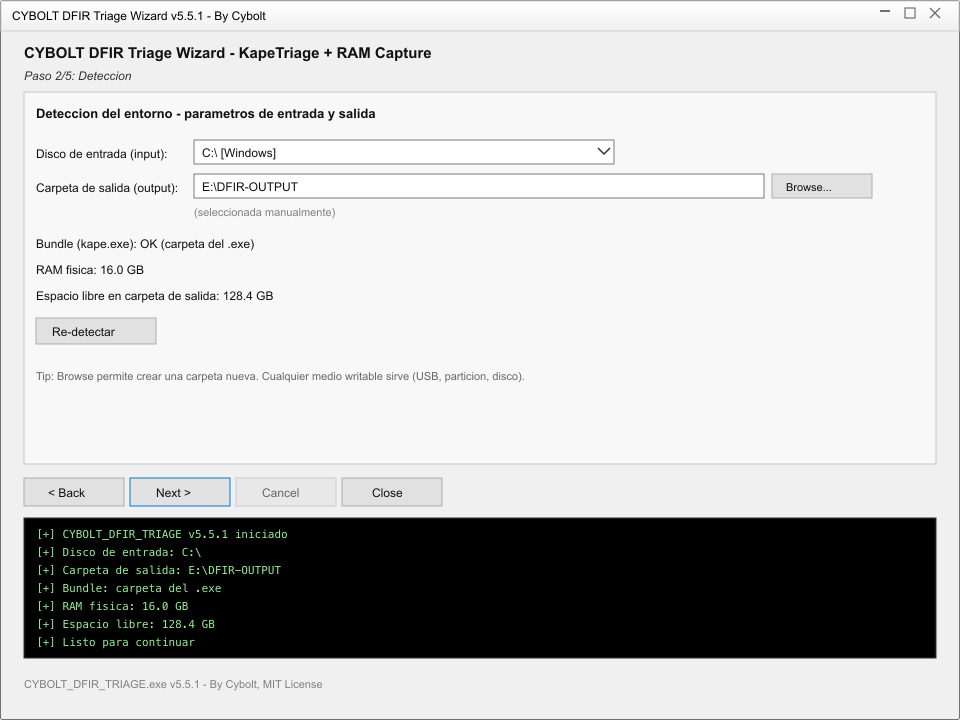

# CyboltDFIR Triage

Wizard de adquisición forense para Windows. KAPE 1.3.0.2 + captura de RAM
opt-in, empaquetado como un bundle ZIP que se descomprime en un medio
writable y se ejecuta en el equipo objetivo.

- **Procedimiento operativo:** [`docs/OPERATIVO.md`](docs/OPERATIVO.md)
- **Guía para agentes / development:** [`AGENTS.md`](AGENTS.md)

## Flujo del wizard



| Paso | Panel | Qué hace |
|---|---|---|
| 1 | Bienvenida | RAM opt-in (default OFF), cmd wrapper |
| 2 | Detección | Disco de entrada + carpeta de salida (Browse / crear carpeta) |
| 3 | KapeTriage | Stage + KAPE `--vss` → ZIP |
| 4 | RAM Capture | winpmem → `.raw` (se omite si paso 1 OFF) |
| 5 | Resumen | Paths + SHA-256 |



> Mockups de documentación (fieles al layout WinForms). No son captura E2E
> en Windows — el drill real sigue pendiente.

## Quickstart

```bash
./build.sh              # usa la version de VERSION.txt
./build.sh 0.3.1        # fuerza la version de release

# Output: dist/CyboltDFIR-Triage-v<VERSION>.zip
```

Requiere .NET SDK 8. El script verifica `kape.zip` y `winpmem` por SHA-256.

## Componentes

- `DfirTriageUi/` — C# WinForms wizard (`CYBOLT_DFIR_TRIAGE.exe`), .NET Framework 4.5.2
- `targets-full.txt` — lista de KAPE targets a adquirir (filtrado defensivo)
- `kape.zip` — fuente de `Targets/` y `Modules/` (verificado por SHA-256, no trackeado)
- `VERSION.txt` — changelog del bundle

## Uso

El operador descomprime el bundle en un medio writable (USB o disco) y ejecuta
`CYBOLT_DFIR_TRIAGE.exe` en el equipo objetivo. El wizard:

1. **Bienvenida** — opciones: capturar RAM (opt-in, default OFF), cmd wrapper
2. **Parámetros** — elegís el **disco de entrada** (ComboBox con los discos
   fijos y removibles; default `C:`) y la **carpeta de salida** (TextBox +
   `Browse…`). Default sugerido: primer disco removible → `C:\DFIR-OUTPUT`
   (cualquier carpeta writable vale; no se exige un label de volumen). Todo
   lo que produce el wizard (staging,
   ZIP, `.raw`, resumen) queda en esa carpeta.
3. **KapeTriage** — stagea `kape.exe` + `Targets/` a la carpeta de salida y
   corre KAPE con `--vss` (incluye Volume Shadow Copies)
4. **RAM Capture** — solo si la marcaste en el paso 1 (default OFF)
5. **Resumen** — paths y SHA-256 de cada output

### Parámetros

| Parámetro | Dónde | Default | Notas |
|---|---|---|---|
| Disco de entrada | Paso 2, ComboBox | `C:` | Discos fijos + removibles. `--tsource` de KAPE |
| Carpeta de salida | Paso 2, TextBox + Browse | autodetectada | `FolderBrowserDialog`, acepta escribir a mano |
| Captura RAM | Paso 1, checkbox | OFF | Opt-in |
| cmd wrapper | Paso 1, checkbox | OFF | Para servers con spam de Console Title |

El `Browse…` es un `FolderBrowserDialog` nativo: deja navegar, crear carpeta
nueva (`ShowNewFolderButton`) y escribir la ruta a mano. `Re-detectar` respeta
la carpeta elegida a mano y solo reevalúa bundle, discos de entrada y RAM.

## Releases

- [GitHub Releases](https://github.com/Beacon-Lab-IR/cybolt-dfir-triage/releases)
- Cada release publica `CyboltDFIR-Triage-v<VERSION>.zip` con su SHA-256
- El bundle se construye en CI (Linux) al pushear un tag `v*`

> El asset publicado por CI no es byte-idéntico al build local (distinto SDK).
> El hash a verificar es el de las notas del release.

## Ecosistema CyboltDFIR

Este proyecto es self-contained (solo Triage). Los otros proyectos:

- [Beacon-Lab-IR/cybolt-dfir-uploader](https://github.com/Beacon-Lab-IR/cybolt-dfir-uploader) — subidor standalone (S3/FTP/SFTP/SMB), con config JSON remoto
- [Beacon-Lab-IR/cybolt-dfir-iso](https://github.com/Beacon-Lab-IR/cybolt-dfir-iso) — ISO no-booteable que combina Triage + Uploader

## Licencia

By Cybolt, MIT License.
